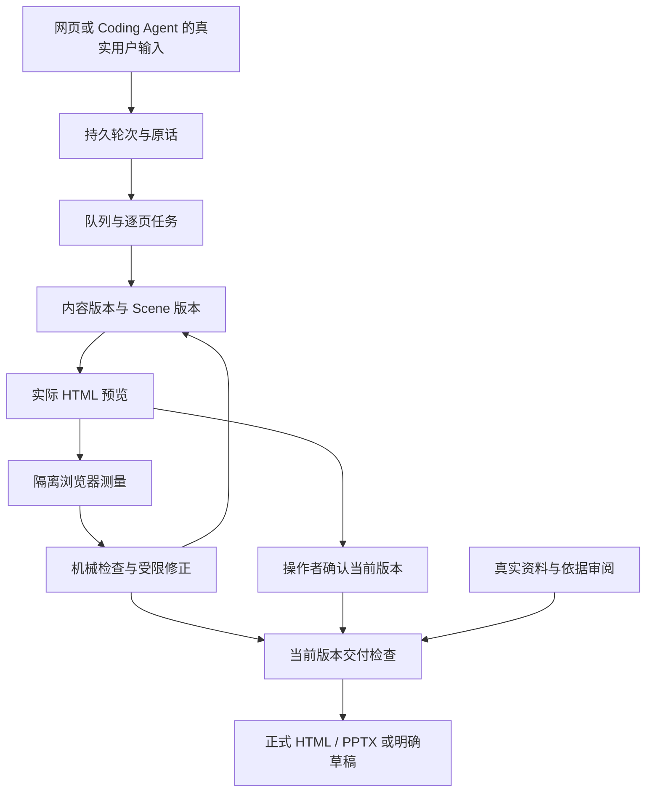

# PPT Workbench 0.4：用户轮次、逐页任务与当前版本交付

## 1. 设计目标与执行边界

0.4 在逐页制作核心之上增加持久的用户交互轮次：首轮需求与材料，第二轮集中反馈，第三轮明确整稿确认。用户的一条整稿要求可以产生多个后台页任务；页任务完成后汇总为同一轮结果。总轮数、实际版式检查、操作者认可和正式交付条件分别记录。

本版提供本地聊天工作台、CLI、33 个 MCP 工具、Claude Code / Codex 非交互适配器，以及不调用模型的本地大纲排版。浏览器显示实际生成的 HTML；PPTX 来自同一可编辑 Scene。模型账号、客户端登录和云端托管不包含在项目中。

## 2. 输入层：保留思想，集中补齐必要决定

SQLite 保存项目简报、逐页用户思想、拟用表达、对话、材料、任务、场景版本、交付轮次和审阅记录。模型的候选文字与用户原话分开；网页新页来源由服务绑定实际用户消息，不采信模型自行声称的原话。

`intake.py` 只读取明确命名的元信息：用途、听众、目标、展示方式、Logo 策略、数据策略，以及整稿或逐页的依据要求。现场讲述、独立阅读和两者兼用映射到稳定枚举；未知、冲突或尚未决定的输入保持缺口，不自动补默认值。

用户声明 `数据策略：无需外部资料` 不自动推导每页 `evidenceNeed=no`。需用 `本稿各页依据要求：无需外部依据`，或在相应页明确声明。反过来，`依据要求：需要核验` 也不是核验通过。原文包含元信息并保留来源，页面展示正文与项目设置分别处理。

缺项聚合成至多三个问题组。前端将 `intakeChoice` 的多行选项按 `groupId` 整块互斥替换，不同组及自由补充累积到同一输入框。点击选项本身不提交；用户一次发送才创建轮次。页面问题选项单独携带原问题 ID 与页归属，汇总消息不能替代原问题身份。

## 3. 轮次账本：计的是用户输入

`delivery.py` 将首次需求、补充回答、集中修改及操作者的撤销/认可提交保存为用户轮次。每轮绑定输入消息、任务、变更页、最终输出消息、检查摘要与结果快照。请求 ID 去重使同一次提交的网络重试不会增加轮数。

轮次状态包括 `processing / waiting_agent / checking / needs_input / ready / failed / cancelled`。页面已生成但还等待浏览器测量时，可以建立一条完整结果记录并处于 `checking`；后续测量与受限修正更新同一结果，而不是增加一个输出轮。因而 `outputCount` 仅表示结果记录数量，不代表这些结果已经通过交付检查。

自动页任务、重跑机械检查、浏览器补测和原轮失败重试均不增加用户输入。补充观点或回答则是新用户输入，不伪装成后台任务。第四轮仍可运行，`withinTarget` 如实变为 false，重启、换模式或撤销不能重置历史。

结果快照包含项目、内容版本、场景版本及相关哈希。后续变化使 `snapshotStale` 成立，旧轮不能当作当前结果。自动修正只有沿原轮已授权版本链才能更新其快照，外部修改不能偷偷并入同轮。

兼容历史项目保留原记录，不倒推缺失的人类输入。在已有轮次后，未绑定任务/轮次的低层 CLI / MCP 核心变更进入 `externalChanges`，令 `interactionAccountingComplete` 为 false。新轮或确认不会抹掉该标记；三轮达标要求计量链完整。直接绕过程序改数据库或文件不在这套审计机制的保证内。

## 4. 编排层：一轮内逐页制作或修改

### 初稿计划

`deck_flow.py` 保存 2–30 页计划、用户原始需求、执行模式、页序、当前任务和每页结果。一次只推进一个页面；实际 Scene 和页面结果提交后才标记完成，安排下一页。

`agent` 执行模式由真实客户端按上下文制作；`outline` 按用户明确提供的完整文字本地排版。后者不构思新事实，也不代表调用了模型。完成计划之前，整稿导出返回 `DECK_INCOMPLETE`，不会将部分页包装成完整演示。

### 集中跨页反馈

`feedback.py` 解析明确的 `整稿修改\n第N页：指令`，或校验模型返回的单一 `deck_feedback`。批次在接收时校验全部页 ID、重复项和版本基准，然后建立固定的单页反馈任务。

每个 `feedback_page` 只修改绑定页，保留可选对象范围。其后自动安排下一页，不让模型重新分派一整稿。分派本身不直接改页面；逐页提交后成果保留。后续一页失败不会伪装成整批完成，也不会丢弃此前已完成页。

普通单页任务仍只能处理一页。选中对象时只接受对应对象补丁，不能升级成整页或跨页调整。缺资料则绑定原问题等待补答；回答后可自动继续，但这条新回答照实占一轮。

暂停保留结果，继续从未完成位置推进；失败重试只重跑可重试任务。取消阻断后续编排和迟到结果应用，不承诺立即终止已发出的外部模型网络调用。

## 5. 页面、对象与并发版本

每页和 Scene 对象都有稳定 ID。内容版本与场景版本独立保存；绑定内容卡的对象修改会回写当前拟用表达，后续生成可保留这些文字修改。原始意图不被普通补丁覆盖。

任务保存提交时的项目、页、对象与基准版本。过期动作返回 `STALE_REVISION`，调用者需要重新读取并评估，不得仅换版本号重试。单页多步计划在数据库事务中执行；后续动作失败时回滚该次提交。

撤销把前一 Scene 保存为新的当前版本，历史不删除。网页撤销与认可通过操作者提交入口计入轮次；低层直接调用仍作为外部变更处理，不能钻计数空隙。

同一项目只允许一个服务持有操作系统文件锁。重启后恢复遗留的运行中任务，完成记录不重复应用。客户端提交使用幂等请求 ID；该保证属于相应队列和操作者提交接口，不外推到所有旧的低层 API。

前端草稿一旦开始输入便固定作用域。旧 iframe、未加载完成的 iframe、与当前版本不符的 iframe 不得接收对象选择。背景续页、测量和新消息不会重定向输入目标。

## 6. 质量闭环：测量、有限修正与待办

`quality.py` 区分几何/容量估算和真实浏览器报告。静态检查可发现越界、主要文字框重叠、已知底色上的低对比、图层遮挡等可计算问题；估算容量偏紧只提示待确认，不能被当成已实测溢出。

实际 HTML 在字体与图像加载后上报文字框 client/scroll 尺寸、字体就绪和图像状态。前端使用与工作预览隔离的 1280 × 720 iframe，单个并发、同版本至多两次失败尝试，不改变当前页、对象或草稿。

前端只接收正在测量 iframe 自身来源的报告，并校验页 ID 与当前场景版本；上传时绑定该 iframe 的版本。后端校验完整对象集合、类型、尺寸与实际 Scene，拒绝过期或不一致报告。字体、图片未就绪或报告缺失保持待测，不按通过处理。

自动修正仅尝试向下扩展文字框：容量估算或浏览器测量提示高度不足，且几何上有足够空间、不会新增内容重叠时才执行。它不移动其他对象、不修改文字或字号、不自动改配色。修正受原轮授权、页范围、对象保护和持久预算限制；精确对象任务不会借检查扩大编辑范围。

修正产生新 Scene 版本，旧报告失效，需要重新测量。收到有效报告后可在同一轮内继续有界检查与修正，不通过无限请求循环追求“全绿”。

质量状态包括：

| 状态 | 含义 |
| --- | --- |
| `not_checked` | 尚未建立本次检查 |
| `stale` | 页面或相关版本已变化，旧检查不能沿用 |
| `awaiting_browser` | 当前版式仍缺可接受的实际浏览器测量 |
| `needs_attention` | 仍有阻断问题或页面尚未完整生成 |
| `ready_to_review` | 机械条件可审阅，等待操作者判断内容与视觉 |

`semanticStatus` 保留 `operator_review_required`。机械检查不是审美、故事质量或事实真实性认证；浏览器报告也不能证明 Microsoft PowerPoint 的最终字体排版相同。

## 7. 整稿确认与正式导出

浏览器只有在整稿完成、当前页面与检查一致且没有内容任务运行时，才允许用户明确“确认整稿”。确认对话框固定完整页版本映射与用户陈述；版本在提交前变化则拒绝，不自动改绑。

`review_deck` 将这次认可作为一个操作者输入轮次，逐页记录当前内容/视觉认可，再汇总对应结果。单页认可和撤销走同类幂等入口。它们不在模型动作协议中，MCP 不提供认可通过工具。

三个条件彼此独立：

- 当前场景有可接受的机械检查及实际浏览器测量。
- 操作者认可当前整稿的表达与视觉，旧版本认可不能沿用。
- 需要的真实资料、依据与审阅满足正式交付检查。

确认整稿不会批准事实依据；`releaseIssues` 持续显示待办。前端正式下载还要求最新轮次快照与当前稿一致，使用 `/api/export?...&strict=1`。缺任一必要条件只能明确导出草稿，不将格式正确或轮数少当作正式完成。

`qualityAccepted`、`releaseReady` 与 `targetSatisfied` 分别表达认可、正式交付和三轮目标。超过三轮后仍可以完成正式稿；交付状态不能改写轮次历史。哈希清单只证明所记录文件与版本的一致性，不证明业务事实。

## 8. 渲染与执行器边界

Scene 为 1280 × 720，支持 text、rect、line、image，同一模型驱动 HTML 与原生可编辑 PPTX。PPTX 依赖 PptxGenJS 4.0.1；缺少 Node 或依赖时明确失败，不输出冒充 PPTX 的文件。

54 条模板知识提供适用条件、布局和容量规则，程序化渲染只有封面、目录、章节、内容、双项比较、并列、流程、结束等八类基础布局。其他模板使用通用回退；本版没有原生 chart/table/video、任意 PPTX 导入、复杂 SVG 编辑或多人协作。

文字附件可读取；图片保留真实 PNG/JPEG 与资产引用，未实际读取时不声称理解图片。PDF 当前仅登记，不自动解析。真实来源与核验需要相应材料和实际审阅。

本机服务限制 Host、来源、文件路径与提交类型。非交互适配器使用固定命令参数与 stdin，接收受限结构化动作，不执行任意 shell 计划。客户端是否登录、参数是否兼容及模型是否返回，需要真实调用验证。

## 9. 验证与后续扩展

本轮验证结果统一见 [VALIDATION.md](VALIDATION.md)。JavaScript VM 只验证界面状态和提交逻辑；真实浏览器测量、完整 UI 路径及真实模型端到端验收仍需可连接的用户环境，步骤见 [UI_ACCEPTANCE.md](UI_ACCEPTANCE.md)。不能用代码测试替代实际页面验收。

扩展模板、图表、材料解析或其他客户端时，保留用户原话、页面与对象 ID、作用域、版本基准、轮次归属和当前结果快照。新增自动修正应有可验证依据、范围和停止条件，不能用更长提示词替代程序约束。
